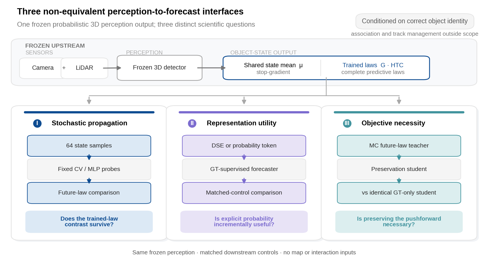
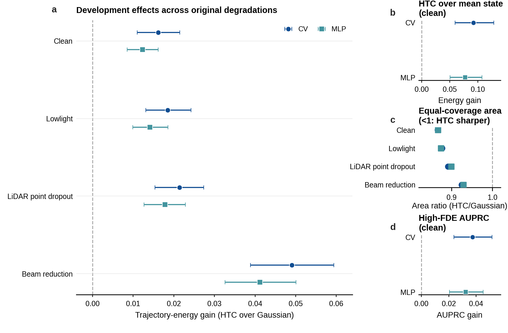
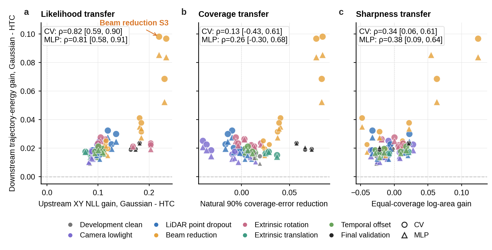
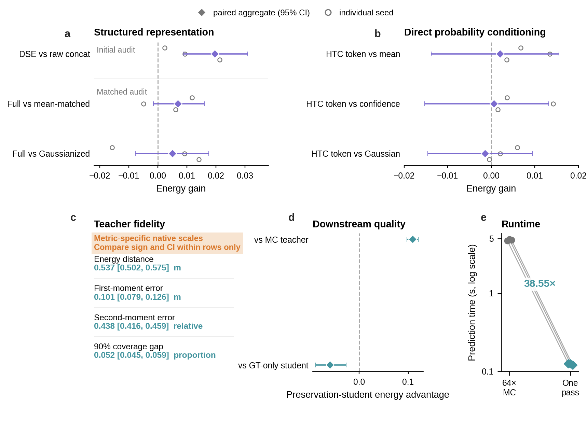
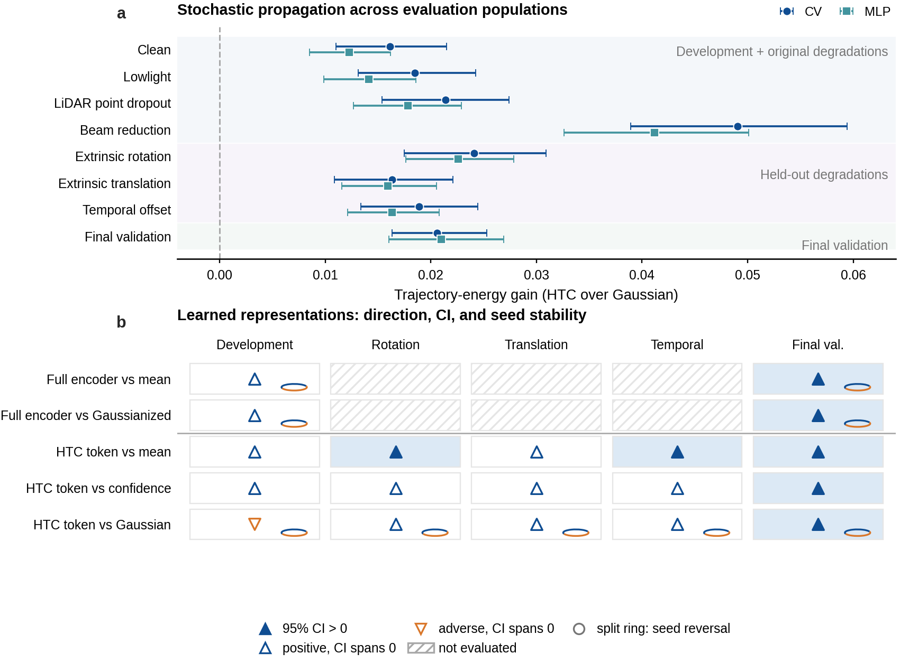

# When Does Probabilistic 3D Perception Help Motion Forecasting? A Controlled Interface Study under Multimodal Sensor Degradation

**Author One**, **Author Two**, **Author Three**

*Affiliations to be inserted*

*Corresponding author: to be inserted*

> Draft v0.6 for IEEE Transactions on Intelligent Transportation Systems. The scientific structure and reported evidence are fixed. Author metadata, final figures, repository DOI, and venue-specific formatting remain to be supplied.

## Abstract

Standard forecasting evaluations often rely on curated or ground-truth object histories, although deployed predictors consume states produced by imperfect perception. This leaves two questions unresolved: whether differences between upstream predictive laws survive downstream propagation, and whether a supervised forecaster must receive those laws explicitly. We study three levels of an object-centric interface: **stochastic propagation value**, tested by propagating complete laws through fixed forecasting probes; **representation utility**, tested with capacity-, confidence-, and distribution-matched inputs; and **objective necessity**, tested by distilling the induced future distribution. The study uses a fixed Camera--LiDAR detector, two trained 3D predictive laws with shared detector means, two forecasting probes, six degradation families, and paired scene-level inference. The stochastic-law contrast retained its direction across development, held-out degradations, and final validation. On final validation, trajectory-energy gains were 0.02060--0.02101 across the probes, with equal-coverage area ratios near 0.854. Learned uncertainty representations were less stable: matched encoders and direct probability tokens varied with seed, comparator, and evaluation population, and did not support a component-level mechanism. The stochastic future distribution was compressible, but preserving it was not preferable to identical ground-truth-only training. This reveals an observed interface-stability asymmetry: a predictive-law difference can survive stochastic transformation without becoming a universally useful learned representation or training target. Within this controlled setting, stochastic propagation provides a consistent diagnostic of downstream probabilistic value, whereas learned uncertainty interfaces require separate evidence of incremental utility.

**Keywords:** autonomous driving; motion forecasting; probabilistic 3D perception; sensor degradation; uncertainty propagation; calibration; reliability

## 1. Introduction

Motion forecasting connects environmental perception to downstream planning. A predictor must infer plausible futures for surrounding vehicles, pedestrians, and cyclists from states reconstructed from cameras, LiDAR, and other sensors. Modern forecasting architectures effectively represent agent histories, maps, interactions, and multimodal futures [7]--[10]. In deployment, however, their object-state inputs are estimates rather than direct observations. Their accuracy varies with illumination, point density, calibration, synchronization, occlusion, and hardware condition. Camera--LiDAR fusion improves nominal 3D perception [2], but common-corruption studies show that fused and single-modality detectors remain sensitive to environmental and sensor disturbances [3], [4]. Evaluation with ground-truth tracks alone can therefore obscure uncertainty at the operational perception-to-forecast boundary.

Probabilistic 3D detectors offer a natural interface by representing a current object state as a distribution rather than a single box [5], [6]. A predictive distribution may affect motion forecasting in at least three distinct ways. First, its samples may induce different futures when propagated through fixed dynamics. Second, its parameters or summaries may provide useful features to a supervised predictor. Third, the future distribution induced by repeated propagation may itself be a useful training target. These statements are often grouped under *uncertainty-aware forecasting*, but they are not logically equivalent. A predictive law may have measurable stochastic propagation value without a learned token exploiting it; a student may reproduce a stochastic teacher without that teacher being the best objective when future labels are available. Our first question is therefore not whether one law creates information absent upstream. It is whether upstream probabilistic-quality differences survive a fixed forecasting computation, remain sharp after propagation, and transfer across sensor perturbations.

The distinction matters for both modular and joint autonomous-driving systems. Joint perception--prediction methods pass features, tracks, or queries across tasks [13]--[17], potentially reducing information loss at hand-designed interfaces. Yet a gain from a richer interface can reflect additional capacity, confidence, different supervision, or the probability distribution itself. Conversely, a null result for an explicit uncertainty token does not negate a positive stochastic pushforward result. The closest object-state studies ask how perceptual uncertainty can be incorporated into trajectory forecasting and report benefits from uncertainty-aware objectives or feature encoders [23], [26]. Our question is different: whether stochastic propagation value, explicit representation utility, and preservation-objective necessity are empirically equivalent. We separate them with matched mean, confidence, Gaussian, capacity, and identical GT-only controls; derive uncertainty from Camera--LiDAR 3D perception under six sensor degradations; and retain both positive and null outcomes as an applicability boundary. Related studies address uncertain association from detections [24], [25] and uncertain online maps [18].

We address this gap through a controlled study of an **object-centric perception-to-forecast interface conditioned on correct object identity**. The identity condition is deliberate: ground-truth instance identifiers associate observations and future targets, allowing state uncertainty to be isolated from identity switches, track birth and death, false tracks, and missed-track continuity. The forecasting hosts are a constant-velocity model and a lightweight residual multilayer perceptron (MLP). They are not presented as state-of-the-art forecasting baselines; they are structurally different, fixed probes designed to expose the downstream consequences of the same probabilistic perception input without map or interaction confounders.

The study is organized around a single scientific question:

> When upstream 3D perception outputs a predictive distribution, where does that probability information affect downstream motion forecasting?

We answer it at three levels. At the **stochastic-propagation level**, trained Gaussian and heavy-tailed/circular predictive laws are propagated through fixed probes. At the **representation level**, supervised predictors receive either a structured distributional encoding or a direct probability token, with controls for capacity, detector confidence, and Gaussian uncertainty. At the **objective level**, a single-pass student is trained either to preserve the Monte Carlo future distribution or only against future ground truth. All learned models use clean training data; lowlight, LiDAR dropout, beam reduction, camera extrinsic rotation and translation, and temporal offset are evaluation conditions.

The paper makes three contributions:

1. **A controlled evaluation framework.** We separate stochastic computation, learned representation, and learning objective while matching the relevant detector means, forecasting architecture, initialization, data, and supervision controls. The framework evaluates both average predictive quality and future-error ranking under Camera--LiDAR degradation.
2. **A robust stochastic-propagation finding.** Differences between the two trained upstream predictive laws survive two structurally distinct forecasting probes, six degradation families, and development and final-validation populations. The gain is retained at equal coverage rather than obtained by enlarging the forecast region.
3. **A learned-interface applicability boundary.** Stable stochastic value does not imply universal learned-interface utility: structured representations are seed- and control-sensitive, direct probability conditioning is evaluation dependent, and preserving a Monte Carlo pushforward is not a necessary objective when direct future supervision is available.

The intended conclusion is therefore neither that uncertainty always helps nor that it is dispensable. The evidence distinguishes a stable property of explicit stochastic propagation from the more conditional utility of learned probability interfaces.

## 2. Related Work

### 2.1 Probabilistic 3D perception

Multi-sensor 3D perception combines camera semantics with LiDAR geometry. BEVFusion aligns both modalities in a shared bird's-eye-view representation and provides the detector backbone used in this study [2]. Nominal accuracy alone does not characterize deployment reliability: Dong *et al.* benchmark camera and LiDAR common corruptions across 3D detectors [3], and Robo3D studies LiDAR perception under environmental corruptions and sensor failure [4]. Our study follows the disturbance downstream while holding the detector fixed.

Probabilistic detectors explicitly represent localization uncertainty. LaserNet predicts multimodal distributions over 3D boxes [5], and Feng *et al.* show that calibration of probabilistic detection must be evaluated rather than assumed [6]. We use two previously trained probabilistic side heads--a Gaussian/wrapped-Gaussian law and a Student-t/von Mises law--as upstream inputs. They are not algorithmic contributions of this paper. The focus is whether their predictive distributions affect future trajectories after the current-state mean is controlled.

### 2.2 Motion forecasting with imperfect perception

Modern forecasting methods use structured scene representations and multimodal decoders. VectorNet encodes map and agent polylines [7], LaneGCN models lane topology and actor--map interaction [8], and Motion Transformer and MotionLM model multimodal or joint futures with query-based and autoregressive formulations [9], [10]. Most benchmark settings nevertheless provide curated tracks or assume that tracking has already produced agent histories.

Several studies move closer to the operational perception interface. Ivanovic *et al.* explicitly incorporate perceptual state uncertainty into trajectory forecasting with a statistical-distance objective and report better-calibrated predictions [23]. Cao *et al.* encode perception-information uncertainty within an interaction-aware vehicle trajectory predictor [26]. These works primarily ask how to use upstream uncertainty to improve a forecaster. Ours asks whether three claims often inferred from such positive results are equivalent: value under stochastic propagation, incremental utility of an explicit representation, and necessity of preserving the induced future distribution. We therefore compare complete stochastic laws, match representation capacity and initialization, control for ordinary confidence and Gaussian uncertainty, and compare preservation training with an identical GT-only learner. The upstream laws come from Camera--LiDAR 3D perception and are evaluated under six degradation families; the intended result is an applicability boundary rather than a uniformly positive uncertainty-aware method. Supplementary Table S1 makes these research-design distinctions explicit without treating them as a ranking of prior work. Weng *et al.* address tracking errors with affinity-based prediction rather than hard association [24], while Zhang *et al.* forecast directly from detections using uncertainty-aware affinity encoding [25]. We condition on correct identity and do not claim robustness to tracking errors.

### 2.3 Perception--prediction interfaces

Joint perception and prediction aim to reduce error accumulation and information loss in modular systems. PnPNet jointly optimizes detection, tracking, and forecasting [13]. FIERY predicts probabilistic future instances from surround-camera video [14], BEVerse shares a spatio-temporal bird's-eye-view representation across perception and prediction [15], ViP3D carries 3D agent queries into forecasting [16], and UniAD links perception, prediction, and planning with query interfaces [17]. Multi-view features have also been fused for joint detection and prediction [22], while ForeSight uses shared streaming query memory for joint detection and trajectory forecasting [27].

These systems demonstrate the value of richer differentiable interfaces, but they do not by themselves isolate uncertainty-specific value. A feature or query may improve prediction because it carries appearance, context, confidence, or additional capacity. Uncertain online mapping provides a complementary example: Gu *et al.* represent map uncertainty and improve downstream trajectory prediction [18]. Our object-state controls separate mean, detector confidence, Gaussian uncertainty, heavy-tailed/circular uncertainty, repeated stochastic computation, and future supervision.

### 2.4 Probabilistic propagation and evaluation

Sampling directly propagates a non-Gaussian input distribution through nonlinear dynamics, but repeated forward passes are expensive. Distribution distillation compresses an ensemble or predictive distribution into a single student; Ensemble Distribution Distillation, for example, models the distribution of ensemble predictions rather than only their mean [20]. Perception uncertainty has also been transferred into chance-constrained motion planning [19]. We test whether the empirical future distribution induced by repeated perception samples is both compressible and useful as a training objective, with an identical ground-truth-only student as the decisive control.

A recent proxy-driving study also asks whether explicitly informing an automated agent about perceptual uncertainty changes its behavior [28]. That work concerns a downstream decision policy rather than object trajectory forecasting. It reinforces the need to distinguish the existence of a downstream response from the incremental value of a particular learned forecasting interface.

Distribution-sensitive evaluation is essential. Minimum-of-sample displacement can reward diversity without properly scoring the full predictive distribution. Shahroudi *et al.* advocate the energy score for trajectory distributions [11], building on proper-scoring-rule theory [12]; probabilistic multi-agent dynamics work likewise uses energy score to assess predictive distributions [21]. We therefore use trajectory energy score as the primary metric and report negative log-likelihood, mean displacement, equal-coverage sharpness, and future-error ranking separately.

## 3. Problem Formulation and Interface Taxonomy

### 3.1 Object-centric perception-to-forecast uncertainty

Let \(\mathcal{S}_{\le t}\) denote the Camera--LiDAR observations and matched object history available at time \(t\). A probabilistic detector defines a current-state law

\[
p(X_t\mid\mathcal{S}_{\le t}),
\]

where \(X_t=(S_t,\Theta_t)\) contains linear 3D box/motion coordinates \(S_t\) and yaw \(\Theta_t\). Motion forecasting seeks a distribution over a six-step future center trajectory,

\[
p(Y_{t+1:t+H}\mid\mathcal{S}_{\le t}),\qquad H=6.
\]

The interface question is how information in \(p(X_t\mid\mathcal{S}_{\le t})\) reaches the future distribution. Throughout the study, object identity is conditioned on rather than predicted. Ground-truth instance identifiers are used only to associate detections across frames and obtain future targets. No current ground-truth residual, future state, corruption label, or severity label is available to a model. Consequently, the estimand is **state-uncertainty value conditional on correct identity**, not end-to-end tracking performance.

### 3.2 Three levels of uncertainty use

We organize the study by where the probabilistic information enters the forecasting computation (Fig. 1).

#### Level I: stochastic propagation value

The full current-state law is sampled and propagated through a fixed forecasting probe \(f\):

\[
X_t^{(m)}\sim p(X_t\mid\mathcal{S}_{\le t}),\qquad
Y^{(m)}=f(H_t,X_t^{(m)},C_t)+\varepsilon^{(m)},
\quad m=1,\ldots,64.
\]

Here, \(H_t\) is the observed history, \(C_t\) the object class, and \(\varepsilon^{(m)}\) common calibrated future noise. If changing the trained current-state predictive law changes a proper score downstream while the probe and future-noise construction remain fixed, that law has measurable downstream distributional value under the probe. This is an operational proper-score statement, not an information-theoretic claim, and it does not require a learned uncertainty representation.

#### Level II: representation utility

A supervised predictor receives a fixed-dimensional representation \(r[p(X_t)]\):

\[
q_\theta(Y\mid H_t,\mu_t,r[p(X_t)],C_t).
\]

We test both a structured distributional encoder and a minimal direct token. Their controls ask whether a gain exceeds what can be explained by mean state, parameter capacity, detector score/query density, or Gaussian uncertainty. This level tests incremental utility under future supervision; it does not follow automatically from Level I.

#### Level III: objective necessity

The Level-I empirical future distribution can also supervise a student:

\[
\widehat p_{\mathrm{MC}}(Y\mid X_t)
\longrightarrow q_\theta(Y\mid H_t,p(X_t),C_t).
\]

The key comparison is between two identical students: one trained to preserve the Monte Carlo pushforward in addition to future ground truth, and one trained only on future ground truth. This separates *compressibility* of the stochastic computation from *necessity* of preserving it as a learning objective.

**Table 1. Unified taxonomy of the perception-to-forecast interfaces.**

| Scientific level | Interface under test | Matched controls | Inference question |
|---|---|---|---|
| Stochastic propagation value | 64-sample stochastic pushforward | Mean-state current interface; Gaussian pushforward | Does changing the trained upstream law improve the downstream predictive distribution under a fixed probe? |
| Representation utility | Structured encoder and direct probability token | Capacity-matched mean; confidence/query density; Gaussian token; component ablations | Can a GT-supervised predictor exploit explicit probability information incrementally? |
| Objective necessity | Pushforward-preserving student | MC teacher; identical GT-only student | Is preserving the induced future distribution necessary, rather than merely possible? |

**Fig. 1 | Controlled perception-to-forecast interface taxonomy.** A common frozen Camera--LiDAR detector supplies stop-gradient state means to two previously trained predictive laws. Under the correct-identity condition, probability enters forecasting at three distinct levels: (I) 64-sample stochastic propagation through fixed CV/MLP probes; (II) structured or direct probability representations under future-GT supervision; and (III) preservation of the Monte Carlo future law, tested against an identical GT-only learner. Tracking identity uncertainty is deliberately excluded. The diagram defines the experimental taxonomy; it does not assert a causal heavy-tail/circular mechanism.

## 4. Experimental Protocol

### 4.1 Dataset, splits, and track construction

Experiments use nuScenes metadata [1] with scene-disjoint clean training, label-calibration, development, and final-validation populations. Every eligible target contains two to four consecutive matched historical frames (1--2 s), a current matched detection, and six future ground-truth centers over 3 s. States and future positions are expressed in the current LiDAR coordinate frame. A missing future annotation or fewer than two consecutive matches excludes the target mechanically.

Ground-truth instance identity is used for association and target construction only. This removes identity switches, track birth/death, false-track continuity, and association ambiguity from the present comparison. Current ground-truth residuals and corruption metadata are evaluation-only. All learned forecasters train on clean scenes; degraded scenes are never used for parameter learning.

### 4.2 Upstream perception interface

The upstream detector is a fixed Camera--LiDAR BEVFusion/TransFusion model [2]. Its decoded boxes, class ordering, scores, and selected queries remain unchanged by the probability heads. The detector is frozen throughout probability-head training: decoded means are stop-gradient detector outputs, and neither head can update the detector mean branch. For each retained query, both heads receive the same 128-dimensional decoder feature, ten detached class logits, eight detached decoded linear-state means, and one detector score. Query density is not a probability-head input. Each head uses the same 18,443-parameter architecture; only the likelihood interpretation and training objective differ.

The **Gaussian perception distribution** (implementation label **G**) models the eight linear coordinates with a diagonal Gaussian and yaw with a wrapped Gaussian:

\[
p_{\mathrm{G}}(X_t)
=\mathcal N(S_t;\mu_t,\Sigma_t^{\mathrm G})
\,p_{\mathrm{WG}}(\Theta_t;\mu_t^\theta,\sigma_{t,\theta}^2).
\]

The **heavy-tailed/circular perception distribution** (implementation label **HTC**) uses a diagonal multivariate Student-t law and a von Mises yaw law:

\[
p_{\mathrm{HTC}}(X_t)
=t_{\nu_t}(S_t;\mu_t,\Sigma_t^{\mathrm{HTC}})
\,\mathrm{VM}(\Theta_t;\mu_t^\theta,\kappa_t).
\]

Crucially, G and HTC share the detector's decoded mean \((\mu_t,\mu_t^\theta)\); their learned scales and predictive-law forms differ. Both heads are trained on the same 22,508 clean samples from 560 scenes for 20 epochs with family-specific likelihoods, three head seeds, and identical optimization settings. A disjoint 2,814-sample, 70-scene label-calibration split supplies only the downstream calibration quantities described later; it is not applied to the upstream metrics in Table 2. Both predictive laws, their three head seeds, and all upstream checkpoints were fixed before any downstream forecasting outcome was evaluated. No downstream metric was used to select a law, checkpoint, epoch, or seed. The heads were developed before this study and are inputs rather than proposed methods. Because their likelihood objectives and learned scales differ, G versus HTC is a comparison between two complete trained predictive laws--not a causal intervention on distribution family alone. An HTC advantage therefore cannot be attributed specifically to \(\nu_t\), \(\kappa_t\), Student-t tails, or von Mises geometry.

Table 2 characterizes the two laws before forecasting on the same matched frozen-query rows of the clean development evaluation for each head seed. NLL, natural coverage, and raw scale use the probability heads' uncalibrated outputs: no label-calibration temperature or post-hoc scale correction is applied. The equal-coverage volume is the sole post-hoc descriptive quantity, obtained by rescaling each law on those same rows to empirical 90% coverage. HTC has lower full-geometry, planar-location, and yaw NLL, and its linear coverage is closer to 90%; however, G is slightly closer in yaw coverage and HTC has larger equal-coverage static volumes despite smaller median raw linear scales. This mixed calibration--sharpness profile prevents the downstream comparison from being reduced to either “HTC is calibrated better in every respect” or “HTC merely predicts wider regions.”

The stochastic-propagation comparison is not intended to show that HTC creates new downstream information absent upstream. It tests whether differences already present between the two trained predictive laws survive a fixed forecasting operator, remain sharp after propagation, and generalize across perturbations and evaluation populations. Upstream superiority does not guarantee downstream superiority: nonlinear dynamics, additive process uncertainty, temporal aggregation, and distributional evaluation can attenuate or reorder predictive-law quality. The scientific question is whether the upstream distinction survives this downstream transformation consistently.

**Table 2. Frozen clean-development characterization of the two trained upstream predictive laws on identical matched query rows. NLL, natural coverage, and raw scale use uncalibrated head outputs; only equal-coverage volume uses post-hoc empirical rescaling. Positive NLL contrasts are G minus HTC and favor HTC; coverage gap is empirical minus nominal coverage. Ratio ranges span the three head seeds.**

| Pre-forecast quantity | Frozen characterization |
|---|---:|
| Full-geometry NLL contrast | 4.10243 (95% CI 1.97022, 7.42856) |
| XY NLL contrast | 0.12799 (0.11494, 0.14169) |
| Yaw NLL contrast | 2.71034 (0.62140, 6.01430) |
| Linear 90% coverage gap | G: -0.03827; HTC: +0.01330 |
| Yaw 90% coverage gap | G: +0.02549; HTC: +0.03107 |
| Median linear-scale ratio, HTC/G | 0.758--0.791 |
| Equal-coverage 90% ellipsoid-volume ratio, HTC/G | 1.095--1.249 |

### 4.3 Controlled forecasting probes and learned interfaces

Level I uses two fixed map-free probes: constant velocity (CV) and a 26,380-parameter residual MLP trained once on clean tracks. CV provides an analytic dynamics contrast; the MLP provides a learned nonlinear contrast. Neither is intended to compete with map-aware multi-agent forecasters. Their role is to test whether the perception-law effect survives a change in forecasting computation while scene context remains controlled. Every stochastic result uses 64 propagated samples. Compatible G/HTC linear samples use common random numbers; their circular laws use native samplers.

For each probe, clean label-calibration residuals fit a separate stack of six zero-mean 2D Gaussian covariances, one \(2\times2\) covariance per future horizon. The same probe-specific additive law and common process-noise draws are applied to the mean-state current interface, G propagation, and HTC propagation; no degraded or final-validation outcome enters the fit. Thus, within a probe, the comparison changes the current-state predictive law while holding the future process-noise construction fixed. The mean-state interface remains probabilistic after this shared noise is added and is therefore not called a deterministic future distribution.

At the representation level, all learned groups share the same history/class input and a six-mode diagonal-Gaussian residual trajectory decoder. The structured-encoding comparison includes a full HTC encoder, a parameter-matched mean-only control, a Gaussianized encoder with the same architecture, and no-tail/no-circular variants. The direct-conditioning comparison uses one identical 24,118-parameter network with four fixed-length inputs: mean only; mean plus detector score/query density; mean plus G uncertainty; and mean plus HTC uncertainty. Within each repetition, matched groups share trainable initialization, batch order, epochs, decoder, and ground-truth loss.

At the objective level, the teacher is the 64-sample HTC pushforward through the fixed MLP. The two students have identical inputs, architecture, initialization, and decoder. The GT-only student minimizes future mixture likelihood plus a best-mode displacement term. The preservation student adds sample-distribution, moment, calibration--sharpness, and risk-order matching to the same GT objective. Section S2 gives the complete feature and objective definitions.

### 4.4 Sensor degradation and held-out transfer

The development evaluation contains clean data and three degradation families: camera lowlight, LiDAR point dropout, and LiDAR beam reduction. Each family has pre-specified severities, with full-family and S1/S2 aggregates reported where applicable. After development analyses ended, three additional degradation families were evaluated without changing models or metrics: camera extrinsic rotation, camera extrinsic translation, and camera temporal offset. We call this stage **held-out degradation transfer**; it is a transfer across perturbation families within nuScenes, not an external-dataset evaluation.

### 4.5 Metrics and statistical inference

Trajectory energy score is the primary endpoint because it evaluates the joint sample distribution with a proper scoring rule [11], [12]. Given samples \(Y^{(1)},\ldots,Y^{(M)}\) and target \(y\),

\[
\operatorname{ES}
=\frac{1}{M}\sum_{m=1}^{M}\lVert Y^{(m)}-y\rVert_2
-\frac{1}{2M(M-1)}\sum_{m\ne n}\lVert Y^{(m)}-Y^{(n)}\rVert_2.
\]

Lower is better. Exact or shared-kernel trajectory negative log-likelihood is retained as a diagnostic because its likelihood construction differs across empirical MC and learned mixtures. Predictive-mean ADE/FDE assess mean accuracy. Sharpness is the median final-position ellipse area after each method is scaled to empirical 90% final-position coverage; a smaller equal-coverage area is sharper.

Future-error ranking uses predicted final log ellipse area. High FDE denotes predictive-mean FDE above 2 m under the comparison-specific reference. We report high-FDE AUPRC, risk--coverage, and false-safe rate; false-safe rate evaluates the lowest-risk 80% of tracks within each scene. These are forecast-error triage metrics, not collision or planning-safety outcomes.

Every decisive comparison uses three paired repetitions. Track differences are averaged within scene before inference, and 95% confidence intervals use 10,000 paired-scene bootstrap resamples. Per-seed directions accompany aggregate intervals. Confirmatory claims are restricted to the pre-specified clean and family-level primary contrasts and their joint criteria. Confidence intervals are not adjusted for multiplicity; component, risk, and attribute-stratum intervals are secondary or descriptive, and no family-wise claim is made from an isolated secondary or subgroup interval.

### 4.6 Pre-specification and final confirmation

Hypotheses, comparators, primary metrics, and statistical criteria were specified before the corresponding held-out evaluation. Detailed seeds, integrity checks, feature contracts, and decision criteria are provided in the Supplementary Appendix.

Final confirmation uses 6,019 nuScenes validation metadata samples, producing 68,436 eligible tracks from 150 scenes. The relevant statement is specifically that **downstream forecasting outcomes and interface comparisons on this split were not accessed until the downstream models, metrics, comparisons, and claims were fixed**. It does not imply that the official nuScenes validation data had never been used by any upstream detector-development process. No downstream retraining, recalibration, comparator selection, or metric selection follows final-validation access. The internal test split remains unused.

## 5. Results

### 5.1 Full-distribution stochastic propagation showed stable downstream value

We first test stochastic propagation value without asking a learned model to interpret probability parameters. On the clean development split, propagating the trained HTC law instead of the trained Gaussian law reduced trajectory energy score by 0.01614 (95% CI 0.01102, 0.02150) with CV and by 0.01230 (0.00850, 0.01619) with the MLP. HTC also improved over the mean-state current interface for both probes. The clean HTC-over-Gaussian direction was positive in every repetition.

The effect survived the original lowlight, LiDAR-dropout, and beam-reduction evaluations. Full-family HTC-over-Gaussian energy gains ranged from 0.01411 to 0.04902 across probe--degradation combinations, and the S1/S2-only gains ranged from 0.01222 to 0.02963. Every family point estimate was positive for both probes. Because the forecast host, current-state mean, process-noise model, and compatible random draws were shared within comparison, these effects isolate which trained predictive law is propagated rather than a different mean trajectory or future-noise construction.

Better energy did not result from indiscriminately wider predictions. Development equal-coverage HTC/Gaussian final-area ratios ranged from 0.866 to 0.929, while the largest HTC-versus-mean-state predictive-mean ADE/FDE increases were only 0.01125/0.01692 m. High-FDE AUPRC improved over Gaussian propagation by 0.03745 with CV and 0.03251 with the MLP. Thus the full-distribution effect appears simultaneously in proper-score quality, calibrated sharpness, and future-error ranking.

This result establishes the paper's first anchor: under fixed object identity and controlled forecasting probes, the evaluated HTC predictive law has repeatable downstream distributional value relative to its Gaussian counterpart. It does not establish a pure distribution-family effect, identify which parameter causes the contrast, or show that a supervised model needs any parameter explicitly.

**Fig. 2 | Development evidence for stochastic propagation.** **a,** Trajectory-energy improvement of HTC over Gaussian propagation on clean data and full lowlight, LiDAR point-dropout, and beam-reduction family aggregates for the CV and MLP probes. Positive values favor HTC. **b,** Clean HTC-over-mean-state energy effects. **c,** Final-position ellipse-area ratios after each law is scaled to empirical 90% coverage; values below one favor HTC sharpness. **d,** Clean HTC-over-Gaussian high-FDE AUPRC effects. Points average three paired head/propagation replicates; error bars are 95% intervals from 10,000 paired-scene bootstrap resamples (\(n=70\) development scenes). Within each probe, all current-state interfaces share the same label-calibrated future process-noise law. Source data are provided in `figures/source_data/figure_2.csv`.

Across the fixed population--condition--severity--seed cells, upstream XY-NLL
gains were strongly associated with downstream trajectory-energy gains for
both probes, whereas natural-coverage and equal-coverage sharpness showed
weaker associations. Figure 3 displays this transfer descriptively; the
beam-reduction S3 cluster is labelled because it has high leverage. These
ecological associations do not identify a distribution-family or component
mechanism.

**Fig. 3 | Upstream probabilistic differences and downstream trajectory-energy transfer.** **a,** Scene-weighted HTC gain in uncalibrated XY negative log-likelihood versus the HTC gain in trajectory energy. **b,** Reduction in absolute natural 90% coverage error versus trajectory-energy gain. **c,** Equal-coverage XY log-area gain versus trajectory-energy gain. Each point is one fixed population--condition--severity--head-seed cell; circles denote CV and triangles denote MLP (48 cells per probe; 16 condition clusters; three seeds per cluster). Point size denotes severity and color denotes degradation family or final validation. The beam-reduction S3 leverage cluster is labelled directly. Insets report Spearman \(\rho\) and 95% intervals from 10,000 cluster bootstrap resamples that retain all three seeds within each resampled cluster. Positive values favor HTC. Associations are descriptive and do not identify a tail or circular causal mechanism. Source data are provided in `figures/source_data/figure_3.csv`.

### 5.2 Learned representations did not inherit this value universally

We next test whether explicit probability representations deliver an incremental benefit under ordinary future supervision. Two complementary designs are used: a structured encoder, which gives the model substantial freedom to transform distribution summaries, and a direct token, which minimizes architectural interpretation.

#### 5.2.1 Structured distributional encoding

An initial comparison showed that a dedicated distributional encoder could outperform raw uncertainty concatenation: on clean development data, its energy gain was 0.01965 (0.00895, 0.03100), and its diagnostic NLL gain was 0.19392 (0.10068, 0.28678). This is a local positive result, but raw concatenation does not control for representation capacity.

The parameter- and initialization-matched comparison did not support the stronger interpretation. Full HTC encoding improved clean energy over the mean-only control by 0.00690, but the interval crossed zero (-0.00150, 0.01605). Its gain over the identically structured Gaussianized encoder was 0.00508 (-0.00775, 0.01753). Tail and circular component tests were not jointly supported by their pre-specified overall, mechanism-stratum, risk, sharpness, and seed criteria. Key component and stratum results are reported in Section S4.

Thus, the initial encoder gain did not survive the controls needed for a mechanism claim. A dedicated encoder may help in a particular training run, but the evidence does not support capacity-independent use of HTC information or attribution to Student-t tails or von Mises concentration. Component and stratum results are confined to Section S4.

#### 5.2.2 Direct probability conditioning

The direct-token experiment removes the encoder-capacity explanation. On the clean development split, the HTC token improved energy over mean-only by only 0.00205 (-0.01378, 0.01559) and over detector confidence/query density by 0.00069 (-0.01531, 0.01321). It was non-significantly worse than the Gaussian token: Gaussian-minus-HTC was -0.00140 (-0.01454, 0.00943). Original degradation-family effects were also non-significant, and one repetition reversed the HTC-versus-Gaussian clean direction.

The direct token nevertheless retained a narrower signal. Clean risk--coverage improved over mean-only by 0.00699 (0.00065, 0.01369) and over confidence by 0.00672 (0.00027, 0.01381), without material loss of mean accuracy or equal-coverage sharpness. Explicit probability conditioning can therefore affect failure ranking even where its average trajectory-energy increment is unresolved. Section 5.5 examines that metric distinction directly.

Together, the structured and direct tests answer the representation-level question: full stochastic value does not automatically become stable incremental value when probability information is encoded as supervised features.

### 5.3 Preserving the stochastic pushforward was not a necessary learning objective

The Monte Carlo future distribution is highly compressible. Relative to the identical GT-only student, the preservation student was closer to the teacher on clean development data in sample energy distance by 0.53689 (0.50198, 0.57474), first-moment error by 0.10111 (0.07879, 0.12572), relative second-moment error by 0.43758 (0.41599, 0.45856), and absolute 90% coverage gap by 0.05178 (0.04484, 0.05903). It also outperformed the MC teacher on downstream energy by 0.10957 (0.09758, 0.12076), retained risk ranking and sharpness, and reduced measured prediction time by 38.55-fold.

Compressibility, however, is not objective necessity. The GT-only student reduced clean trajectory energy by 0.05941 (0.02657, 0.08835) relative to the preservation student, and every clean repetition favored GT-only training. The same adverse preservation direction appeared across the original degradation families. Diagnostic mixture NLL also favored GT-only training by 0.60502 (0.49776, 0.70776).

The contrast resolves a common ambiguity in distillation studies. Teacher fidelity shows that a student can preserve an expensive stochastic computation. It does not show that the preserved computation is the best target once direct future labels are available. Here, the student learned teacher moments, coverage, and risk behavior efficiently, but the additional preservation objective reduced the pre-specified downstream proper score relative to the same architecture trained only on ground truth.

**Fig. 4 | Learned-interface and objective controls.** **a,** The initial DSE-over-raw-concatenation energy result is shown beside the parameter- and initialization-matched full-encoder contrasts against mean-only and Gaussianized controls. Diamonds denote aggregate effects and open circles show the three seed directions. The initial and matched audits use different paired training repetitions, so their effect magnitudes are not directly paired. **b,** Direct HTC-token energy effects against mean, confidence, and Gaussian controls under identical GT-only training. **c,** Teacher-fidelity error reductions of the preservation student relative to the GT-only student. Values and 95% intervals remain on metric-specific native scales and must not be compared across rows. **d,** Preservation-student trajectory-energy advantage using one fixed sign convention: positive against the MC teacher but negative against the GT-only student. **e,** Paired prediction runtime for 64-forward MC and one-pass preservation. Aggregate error bars are 95% intervals from 10,000 paired-scene bootstrap resamples (\(n=70\) development scenes); runtime lines are the three paired replicates. Component and attribute-stratum results remain supplementary. Source data are provided in `figures/source_data/figure_4.csv`.

### 5.4 Generalization differed between stochastic and learned interfaces

Held-out degradation transfer and final validation expose the paper's main cross-population contrast. The full stochastic effect is stable; the learned-interface effects are heterogeneous.

Under camera extrinsic rotation, translation, and temporal offset, HTC stochastic propagation significantly improved energy over Gaussian propagation for both probes. Gains ranged from 0.01595 to 0.02411 across probe--degradation combinations. The corresponding HTC-over-mean-state effects were also significant, and equal-coverage HTC/Gaussian area ratios ranged from 0.861 to 0.896. These perturbations were not part of the original lowlight/dropout/beam evaluation, so they extend the observed stochastic propagation value across six degradation families without claiming transfer to a new dataset. Exact family effects are retained in Supplementary Table S2.

Final validation confirmed the stochastic effect on a held-out evaluation population. HTC improved energy over Gaussian propagation by 0.02060 (0.01632, 0.02532) with CV and 0.02101 (0.01603, 0.02688) with the MLP. Its gains over the mean-state interface were 0.12528 (0.09446, 0.15992) and 0.12382 (0.09352, 0.15787), respectively. Every final-validation repetition favored HTC for both probes and both comparators. Equal-coverage HTC/Gaussian area ratios were 0.8549 and 0.8537.

Learned representations did not show the same invariance. In held-out degradation transfer, the direct HTC token significantly improved over mean-only under rotation by 0.01734 (0.00484, 0.03223) and temporal offset by 0.01916 (0.00369, 0.03599), but not under translation. It did not significantly outperform confidence or Gaussian conditioning in any held-out family, and at least one repetition reversed HTC versus Gaussian in each family.

Final validation was more favorable to learned representations than development. Full structured encoding improved energy over mean-matched and Gaussianized controls, but a third repetition reversed all matched comparisons, the no-tail contrast was null, and the full-encoder/mean-only equal-coverage area ratio was 1.0728. Direct HTC conditioning improved energy over mean-only, confidence, and Gaussian tokens, with small favorable area ratios; one repetition still reversed HTC versus Gaussian.

The objective-level conclusion remained more consistent. On final validation, the preservation student improved over the MC teacher by 0.09834 (0.08768, 0.10803), but did not beat the GT-only student: GT-only-minus-preservation was -0.01740 (-0.04238, 0.00968), with all three point directions favoring GT-only. Diagnostic NLL favored GT-only by 0.58845, and the preservation student's equal-coverage area was 2.7151 times that of GT-only. Table 3 consolidates the final-validation contrasts; the complete learned-interface table is retained as Supplementary Table S3.

**Table 3. Compact final-validation results. Values are baseline minus candidate, so positive energy favors the candidate. Area ratio is candidate/baseline at empirical 90% coverage.**

| Level | Candidate | Baseline | Energy effect (95% CI) | Area ratio | Seed signs |
|---|---|---|---:|---:|---|
| Stochastic, CV | HTC | Gaussian | 0.02060 (0.01632, 0.02532) | 0.8549 | + / + / + |
| Stochastic, MLP | HTC | Gaussian | 0.02101 (0.01603, 0.02688) | 0.8537 | + / + / + |
| Structured representation | Full HTC encoder | Mean-matched | 0.03115 (0.01784, 0.04570) | 1.0728 | + / + / - |
| Structured representation | Full HTC encoder | Gaussianized encoder | 0.02827 (0.01518, 0.04142) | 0.9648 | + / + / - |
| Direct conditioning | HTC token | Mean-only | 0.02702 (0.01588, 0.03932) | 0.9874 | + / + / + |
| Direct conditioning | HTC token | Confidence | 0.02092 (0.01112, 0.03217) | 0.9849 | + / + / + |
| Direct conditioning | HTC token | Gaussian token | 0.01682 (0.00456, 0.03051) | 0.9723 | + / - / + |
| Objective | Preservation student | MC teacher | 0.09834 (0.08768, 0.10803) | 0.9427 | + / + / + |
| Objective | Preservation student | GT-only student | -0.01740 (-0.04238, 0.00968) | 2.7151 | - / - / - |

The descriptive attribute analysis is consistent with this separation but does not explain it causally. HTC-over-Gaussian stochastic gains were broadly positive across range, speed, history length, LiDAR point-count proxy, current-residual quartile, and class strata, often increasing under degradation. Direct-token effects were heterogeneous and frequently contracted or reversed. Full stratified results are reported in the Supplementary Appendix; no stratum was used to select a model or formulate a new mechanism.

**Fig. 5 | Observed cross-population interface-stability asymmetry.** **a,** HTC-over-Gaussian stochastic trajectory-energy effects for CV and MLP across clean/original degradations (including LiDAR point dropout), held-out rotation/translation/temporal perturbations, and final validation. Points are paired-replicate means and error bars are 95% paired-scene bootstrap intervals. **b,** Direction and uncertainty of structured-encoder and direct-token representation contrasts across the populations in which each was evaluated. Filled blue upward triangles denote a positive effect with a 95% interval above zero; open blue upward triangles denote positive point estimates whose intervals span zero; open orange downward triangles denote negative point estimates whose intervals span zero; hatched cells were not evaluated. A split blue--orange ring marks at least one seed reversing the aggregate direction. Development and held-out analyses use \(n=70\) scenes, final validation uses \(n=150\), and every contrast contains three paired seeds. Learned-representation magnitudes are not compared across unmatched experiments. Source data are provided in `figures/source_data/figure_5.csv`.

### 5.5 Risk-ranking utility could survive without average proper-score gains

Future-error ranking reveals a narrower form of utility than average trajectory energy. At the stochastic-propagation level, the result was consistent with the primary score. On final validation, HTC-over-Gaussian high-FDE AUPRC gains were 0.03099 (0.02033, 0.04185) for CV and 0.01988 (0.01034, 0.02946) for the MLP. Risk--coverage improved by 0.00889 (0.00087, 0.01726) and 0.00855 (0.00142, 0.01768), while false-safe rate improved by 0.01945 (0.01191, 0.02702) and 0.01346 (0.00596, 0.02116). These effects align stable stochastic propagation value with better identification of forecast failures.

At the representation level, risk evidence was more selective. The direct HTC token improved development risk--coverage over mean-only and confidence despite null energy effects. On final validation, risk--coverage gains were 0.02308 (0.01334, 0.03384) over mean-only and 0.01313 (0.00325, 0.02338) over confidence; false-safe rate also improved over both. No final-validation risk metric significantly improved over the Gaussian token. Held-out degradation results were likewise family and comparator dependent.

The preservation student retained teacher risk behavior, but that success cannot establish objective necessity because the identical GT-only control remained better on development energy and NLL. Risk retention and average distributional quality are separate endpoints.

Accordingly, explicit probability representations may support selective use--for example, prioritizing forecasts for review or conservative handling--even when their average proper-score advantage is unstable. This interpretation is restricted to high-FDE triage based on predicted ellipse area. It is not evidence of lower collision risk or safer planning. Supplementary Figure S1 shows the proper-score and risk-ranking effects side by side.

### 5.6 Evidence synthesis

Table 4 summarizes the applicability boundary. The complete predictive law is most reliable as a stochastic input to a fixed computation. Once future supervision and a learned interface are introduced, incremental value depends on how uncertainty is represented and what objective and evaluation population are used.

**Table 4. Main conclusion table.**

| Scientific level | Probability input or target | Primary energy evidence | Future-error risk evidence | Supported interpretation |
|---|---|---|---|---|
| Stochastic propagation value | Samples from the complete current-state predictive law | Positive across probes, six degradation families, development, and final validation | Consistent gains over Gaussian and mean-state propagation | The evaluated HTC law has repeatable downstream distributional value relative to the trained Gaussian law under controlled probes |
| Representation: structured encoder | Hand-designed distribution summaries | Local positives; unstable under capacity, component, and seed controls | Mixed beyond mean-only | Learned mechanism is bounded; heavy-tail/circular causal attribution is unsupported |
| Representation: direct token | Explicit parameters under GT-only training | Development null, held-out heterogeneity, final-validation positive aggregate | Narrow and comparator dependent | Explicit conditioning can help, but is not universally necessary |
| Objective: pushforward preservation | Empirical MC future distribution during training | Better than MC teacher; not preferable to identical GT-only training | Teacher behavior retained | Stochastic computation is compressible, but preservation is not a necessary objective |

## 6. Discussion

### 6.1 Why stochastic value does not imply learned necessity

The central finding within this controlled study is an **observed interface-stability asymmetry**. Stochastic pushforward asks what future distribution results when uncertainty in the current object state is propagated through fixed dynamics; learned conditioning asks whether a supervised model needs parameters of that uncertainty distribution as explicit inputs. The first contrast remained stable across probes, degradations, and evaluation populations, whereas the second varied with representation, comparator, seed, and population. Formally, the first is a property of a predictive law combined with a computation; the second is an incremental-utility claim under a representation, hypothesis class, optimization path, and supervision regime.

The first claim is strongly supported here. The evaluated HTC predictive law improves trajectory energy over its trained Gaussian counterpart across CV and MLP probes, six degradation families, and development and final-validation populations, while retaining or improving equal-coverage sharpness and failure ranking. Shared detector means and within-comparison process noise rule out a changed point forecast or wider future-noise model as simple explanations. They do not make this a pure distribution-family intervention: the laws also differ in learned scales and family-specific likelihood training.

The stronger learned claim is not supported universally. A GT-supervised forecaster already observes history, mean state, and class and can learn correlations with future motion. Detector confidence or Gaussian scale may absorb information correlated with an HTC token. Optimization noise can further change which correlated input is used. These are plausible explanations for the contraction from stochastic propagation to learned representation, but the present experiments do not identify a causal mechanism. The matched component comparison and descriptive strata specifically caution against attributing the effect to degrees of freedom or yaw concentration.

### 6.2 Implications for perception--prediction interface design

For modular systems, stochastic pushforward is a useful diagnostic even when 64 repeated evaluations are unsuitable for deployment. It answers whether an upstream predictive law has any demonstrable downstream consequence under a fixed host. A positive result justifies interface study; it does not preselect an encoder or prove that explicit parameters are necessary.

For joint systems such as PnPNet, ViP3D, and UniAD [13], [16], [17], the findings motivate matched uncertainty controls. Passing richer features or queries downstream may preserve appearance, scene context, association evidence, and confidence in addition to uncertainty. An uncertainty-specific claim therefore requires comparisons against mean state, ordinary confidence, Gaussian uncertainty, matched capacity, and direct future supervision. Our controlled probes do not assess whether latent end-to-end features are generally superior; they clarify the evidence needed to call a gain uncertainty specific.

The final-validation direct-token gain also shows why evaluation dependence should not be averaged away. Development, held-out degradation, and final-validation populations give different answers for the learned interface while agreeing for stochastic pushforward. Scene composition, eligibility, corruption-induced feature statistics, and optimization variance could all contribute. Because further post hoc modeling would violate the fixed analysis, the supported conclusion remains at the observed level: learned probability conditioning can help, but its increment is population dependent.

The practical evaluation sequence suggested by these results is compact:

1. establish stochastic propagation value by propagating the complete trained law through a fixed probe;
2. compare learned representations with matched mean, confidence, Gaussian, capacity, and initialization controls;
3. compare any teacher-preserving objective with an identical GT-only learner; and
4. report proper score, equal-coverage sharpness, mean accuracy, failure ranking, and per-seed directions across more than one evaluation population.

These are evaluation principles, not a proposal to replace map-aware or joint forecasting architectures with the probes used here.

### 6.3 Metric-dependent utility

Trajectory energy, diagnostic NLL, equal-coverage area, mean ADE/FDE, and future-error ranking need not agree because they measure different properties. Energy scores the joint sample distribution; NLL depends strongly on likelihood parameterization; equal-coverage area measures sharpness after calibration; ADE/FDE summarize the predictive mean; and risk metrics assess whether uncertainty ranks future failures.

The direct-token results make this separation concrete. Development energy was null while risk--coverage improved over mean and confidence. Final-validation energy and risk improved over those controls, but risk did not improve over Gaussian conditioning. A model may therefore support forecast triage without universally improving the average predictive distribution. Selecting a favorable metric after inspection would erase this boundary, which is why energy remains primary and all adverse diagnostic directions are retained.

### 6.4 Scope and limitations

The study deliberately isolates one interface. All results are conditional on correct object identity. Ground-truth instance identifiers remove association uncertainty, so the study does not cover identity switches, false or missing tracks, track birth/death, or online track management. Methods designed for uncertain association [24], [25] address a complementary problem.

The forecasting hosts are map-free CV and residual-MLP probes rather than modern map-aware, interaction-rich predictors. Their structural difference strengthens causal isolation of the perception-law contrast, but it limits architectural generalization. We therefore claim downstream value for an object-centric controlled interface, not universal behavior in state-of-the-art forecasting or planning systems.

All evidence comes from nuScenes [1], one fixed BEVFusion/TransFusion detector family [2], and two particular trained upstream predictive laws. Held-out degradation transfer broadens perturbation type but not dataset or detector. The stochastic HTC-over-G comparison does not isolate distribution family from the scales and calibration learned under different likelihoods; it therefore does not imply that Student-t/von Mises is universally better than every Gaussian or non-Gaussian alternative. The matched encoder evidence likewise does not identify tail or circular parameters as causal.

The horizon is six future centers over 3 s. Maps, explicit social interaction, scene occupancy, missing modalities, long-horizon world prediction, and closed-loop planning are outside scope. The controlled degradations--lowlight, point dropout, beam reduction, extrinsic rotation/translation, and temporal offset--do not exhaust weather, calibration, hardware, or domain shift.

Finally, high-FDE AUPRC, risk--coverage, and false-safe rate evaluate future-error identification, not collision avoidance, comfort, or planning safety. The study uses a staged pre-specified analysis, and later comparisons were scientifically motivated by earlier results. The full governance history is retained in the Supplementary Appendix so that readers can distinguish the unified paper framework from the chronology of model testing.

## 7. Conclusion

This controlled study observes an interface-stability asymmetry in probabilistic perception-to-forecast coupling. Explicit stochastic propagation provides the most stable evidence: differences between the two trained upstream predictive laws survive two forecasting probes, six degradation families, and two evaluation populations while improving trajectory energy, equal-coverage sharpness, and future-error ranking. The same value is not recovered uniformly by structured encoders or direct probability tokens, and preserving the Monte Carlo future distribution is not preferable to identical ground-truth-only training. The predictive-law contrast does not imply a pure distribution-family effect or a stable heavy-tail/circular mechanism. Stochastic propagation is therefore a robust diagnostic within the evaluated interface, whereas learned uncertainty interfaces require separate, matched evidence of incremental utility under their specific supervision, metric, and evaluation population.

## Data Availability

This study uses the publicly available nuScenes dataset subject to its license. Derived track metadata, degradation definitions, metric archives, and a machine-readable evidence ledger are retained with integrity metadata. A public archival URL and any redistribution restrictions will be inserted after the release package is finalized: **[repository/DOI to be inserted]**. The internal test split was not accessed.

## Code Availability

Code for stochastic propagation, learned-interface comparisons, held-out degradation evaluation, bootstrap inference, and final confirmation is retained in the project repository. The public repository URL, environment specification, and checkpoint-access policy will be inserted before submission: **[repository URL to be inserted]**.

## Author Contributions

**[To be completed using the target journal's CRediT taxonomy.]**

## Competing Interests

The authors declare **[no competing interests / statement to be confirmed]**.

## Acknowledgments

**[Funding, computing resources, and acknowledgments to be inserted.]**

## References

[1] H. Caesar, V. Bankiti, A. H. Lang, *et al.*, “nuScenes: A multimodal dataset for autonomous driving,” in *Proc. IEEE/CVF Conf. Computer Vision and Pattern Recognition (CVPR)*, 2020, pp. 11621--11631. [Online](https://arxiv.org/abs/1903.11027)

[2] Z. Liu, H. Tang, A. Amini, *et al.*, “BEVFusion: Multi-task multi-sensor fusion with unified bird's-eye view representation,” in *Proc. IEEE Int. Conf. Robotics and Automation (ICRA)*, 2023, pp. 2774--2781. [Online](https://doi.org/10.1109/ICRA48891.2023.10160968)

[3] Y. Dong, C. Kang, J. Zhang, *et al.*, “Benchmarking robustness of 3D object detection to common corruptions,” in *Proc. IEEE/CVF Conf. Computer Vision and Pattern Recognition (CVPR)*, 2023, pp. 1022--1032. [Online](https://openaccess.thecvf.com/content/CVPR2023/html/Dong_Benchmarking_Robustness_of_3D_Object_Detection_to_Common_Corruptions_CVPR_2023_paper.html)

[4] L. Kong, Y. Liu, X. Li, *et al.*, “Robo3D: Towards robust and reliable 3D perception against corruptions,” in *Proc. IEEE/CVF Int. Conf. Computer Vision (ICCV)*, 2023, pp. 19994--20006. [Online](https://openaccess.thecvf.com/content/ICCV2023/html/Kong_Robo3D_Towards_Robust_and_Reliable_3D_Perception_against_Corruptions_ICCV_2023_paper.html)

[5] G. P. Meyer, A. Laddha, E. Kee, C. Vallespi-Gonzalez, and C. K. Wellington, “LaserNet: An efficient probabilistic 3D object detector for autonomous driving,” in *Proc. IEEE/CVF Conf. Computer Vision and Pattern Recognition (CVPR)*, 2019, pp. 12677--12686. [Online](https://openaccess.thecvf.com/content_CVPR_2019/html/Meyer_LaserNet_An_Efficient_Probabilistic_3D_Object_Detector_for_Autonomous_Driving_CVPR_2019_paper.html)

[6] D. Feng, L. Rosenbaum, C. Glaeser, F. Timm, and K. Dietmayer, “Can we trust you? On calibration of a probabilistic object detector for autonomous driving,” arXiv:1909.12358, 2019. [Online](https://arxiv.org/abs/1909.12358)

[7] J. Gao, C. Sun, H. Zhao, *et al.*, “VectorNet: Encoding HD maps and agent dynamics from vectorized representation,” in *Proc. IEEE/CVF Conf. Computer Vision and Pattern Recognition (CVPR)*, 2020, pp. 11525--11533. [Online](https://openaccess.thecvf.com/content_CVPR_2020/html/Gao_VectorNet_Encoding_HD_Maps_and_Agent_Dynamics_From_Vectorized_Representation_CVPR_2020_paper.html)

[8] M. Liang, B. Yang, R. Hu, *et al.*, “Learning lane graph representations for motion forecasting,” in *Proc. European Conf. Computer Vision (ECCV)*, 2020. [Online](https://www.ecva.net/papers/eccv_2020/papers_ECCV/html/3622_ECCV_2020_paper.php)

[9] S. Shi, L. Jiang, D. Dai, and B. Schiele, “Motion Transformer with global intention localization and local movement refinement,” in *Advances in Neural Information Processing Systems*, vol. 35, 2022. [Online](https://proceedings.neurips.cc/paper_files/paper/2022/hash/2ab47c960bfee4f86dfc362f26ad066a-Abstract-Conference.html)

[10] A. Seff, B. Cera, D. Chen, *et al.*, “MotionLM: Multi-agent motion forecasting as language modeling,” in *Proc. IEEE/CVF Int. Conf. Computer Vision (ICCV)*, 2023, pp. 8579--8590. [Online](https://openaccess.thecvf.com/content/ICCV2023/html/Seff_MotionLM_Multi-Agent_Motion_Forecasting_as_Language_Modeling_ICCV_2023_paper.html)

[11] N. Shahroudi, M. Lepson, and M. Kull, “Evaluation of trajectory distribution predictions with energy score,” in *Proc. 41st Int. Conf. Machine Learning (ICML)*, PMLR 235, 2024, pp. 44322--44341. [Online](https://proceedings.mlr.press/v235/shahroudi24a.html)

[12] T. Gneiting and A. E. Raftery, “Strictly proper scoring rules, prediction, and estimation,” *Journal of the American Statistical Association*, vol. 102, no. 477, pp. 359--378, 2007. [Online](https://doi.org/10.1198/016214506000001437)

[13] M. Liang, B. Yang, W. Zeng, *et al.*, “PnPNet: End-to-end perception and prediction with tracking in the loop,” in *Proc. IEEE/CVF Conf. Computer Vision and Pattern Recognition (CVPR)*, 2020, pp. 11553--11562. [Online](https://openaccess.thecvf.com/content_CVPR_2020/html/Liang_PnPNet_End-to-End_Perception_and_Prediction_With_Tracking_in_the_Loop_CVPR_2020_paper.html)

[14] A. Hu, Z. Murez, N. Mohan, *et al.*, “FIERY: Future instance prediction in bird's-eye view from surround monocular cameras,” in *Proc. IEEE/CVF Int. Conf. Computer Vision (ICCV)*, 2021, pp. 15273--15282. [Online](https://openaccess.thecvf.com/content/ICCV2021/html/Hu_FIERY_Future_Instance_Prediction_in_Birds-Eye_View_From_Surround_Monocular_ICCV_2021_paper.html)

[15] Y. Zhang, Z. Zhu, W. Zheng, *et al.*, “BEVerse: Unified perception and prediction in bird's-eye-view for vision-centric autonomous driving,” arXiv:2205.09743, 2022. [Online](https://arxiv.org/abs/2205.09743)

[16] J. Gu, C. Hu, T. Zhang, *et al.*, “ViP3D: End-to-end visual trajectory prediction via 3D agent queries,” in *Proc. IEEE/CVF Conf. Computer Vision and Pattern Recognition (CVPR)*, 2023, pp. 5496--5506. [Online](https://openaccess.thecvf.com/content/CVPR2023/html/Gu_ViP3D_End-to-End_Visual_Trajectory_Prediction_via_3D_Agent_Queries_CVPR_2023_paper.html)

[17] Y. Hu, J. Yang, L. Chen, *et al.*, “Planning-oriented autonomous driving,” in *Proc. IEEE/CVF Conf. Computer Vision and Pattern Recognition (CVPR)*, 2023, pp. 17853--17862. [Online](https://openaccess.thecvf.com/content/CVPR2023/html/Hu_Planning-Oriented_Autonomous_Driving_CVPR_2023_paper.html)

[18] X. Gu, G. Song, I. Gilitschenski, M. Pavone, and B. Ivanovic, “Producing and leveraging online map uncertainty in trajectory prediction,” in *Proc. IEEE/CVF Conf. Computer Vision and Pattern Recognition (CVPR)*, 2024, pp. 14521--14530. [Online](https://openaccess.thecvf.com/content/CVPR2024/html/Gu_Producing_and_Leveraging_Online_Map_Uncertainty_in_Trajectory_Prediction_CVPR_2024_paper.html)

[19] L. Ding, D. Li, B. Liu, *et al.*, “Safe motion planning for autonomous vehicles by quantifying uncertainties of deep learning-enabled environment perception,” *IEEE Transactions on Intelligent Vehicles*, vol. 9, no. 1, pp. 2318--2332, 2024. [Online](https://doi.org/10.1109/TIV.2023.3297735)

[20] A. Malinin, B. Mlodozeniec, and M. Gales, “Ensemble distribution distillation,” in *Proc. 8th Int. Conf. Learning Representations (ICLR)*, 2020. [Online](https://openreview.net/forum?id=BygSP6Vtvr)

[21] S. H. Sun, R. Walters, J. Li, and R. Yu, “Probabilistic symmetry for multi-agent dynamics,” in *Proc. 5th Annual Learning for Dynamics and Control Conf.*, PMLR 211, 2023, pp. 1231--1244. [Online](https://proceedings.mlr.press/v211/sun23a.html)

[22] S. Fadadu, S. Pandey, D. Hegde, *et al.*, “Multi-view fusion of sensor data for improved perception and prediction in autonomous driving,” in *Proc. IEEE/CVF Winter Conf. Applications of Computer Vision (WACV)*, 2022, pp. 2349--2357. [Online](https://openaccess.thecvf.com/content/WACV2022/html/Fadadu_Multi-View_Fusion_of_Sensor_Data_for_Improved_Perception_and_Prediction_WACV_2022_paper.html)

[23] B. Ivanovic, Y. Lin, S. Shrivastava, P. Chakravarty, and M. Pavone, “Propagating state uncertainty through trajectory forecasting,” in *Proc. IEEE Int. Conf. Robotics and Automation (ICRA)*, 2022, pp. 2351--2358. [Online](https://doi.org/10.1109/ICRA46639.2022.9811776)

[24] X. Weng, B. Ivanovic, K. Kitani, and M. Pavone, “Whose track is it anyway? Improving robustness to tracking errors with affinity-based trajectory prediction,” in *Proc. IEEE/CVF Conf. Computer Vision and Pattern Recognition (CVPR)*, 2022, pp. 6563--6572. [Online](https://openaccess.thecvf.com/content/CVPR2022/html/Weng_Whose_Track_Is_It_Anyway_Improving_Robustness_to_Tracking_Errors_CVPR_2022_paper.html)

[25] P. Zhang, L. Bai, Y. Wang, J. Fang, J. Xue, N. Zheng, and W. Ouyang, “Towards trajectory forecasting from detection,” *IEEE Transactions on Pattern Analysis and Machine Intelligence*, vol. 45, no. 10, pp. 12550--12561, 2023. [Online](https://doi.org/10.1109/TPAMI.2023.3274686)

[26] M. Cao, C. Wang, W. Zhao, and Z. Zhang, “PU-TSI: Interactive vehicle trajectory prediction considering perception information uncertainty,” *IEEE Internet of Things Journal*, vol. 12, no. 15, pp. 30518--30532, 2025. [Online](https://doi.org/10.1109/JIOT.2025.3570741)

[27] S. Papais, L. Wang, B. Cheong, and S. L. Waslander, “ForeSight: Multi-view streaming joint object detection and trajectory forecasting,” in *Proc. IEEE/CVF Int. Conf. Computer Vision (ICCV)*, 2025, pp. 25474--25484. [Online](https://openaccess.thecvf.com/content/ICCV2025/html/Papais_ForeSight_Multi-View_Streaming_Joint_Object_Detection_and_Trajectory_Forecasting_ICCV_2025_paper.html)

[28] N. Grabowsky, A. Mütze, and M. Rottmann, “Does knowledge about perceptual uncertainty help an agent in automated driving?” in *Proc. IEEE/CVF Conf. Computer Vision and Pattern Recognition Workshops (CVPRW)*, 2026, pp. 4219--4229. [Online](https://openaccess.thecvf.com/content/CVPR2026W/SAIAD/html/Grabowsky_Does_Knowledge_About_Perceptual_Uncertainty_Help_an_Agent_in_Automated_CVPRW_2026_paper.html)
