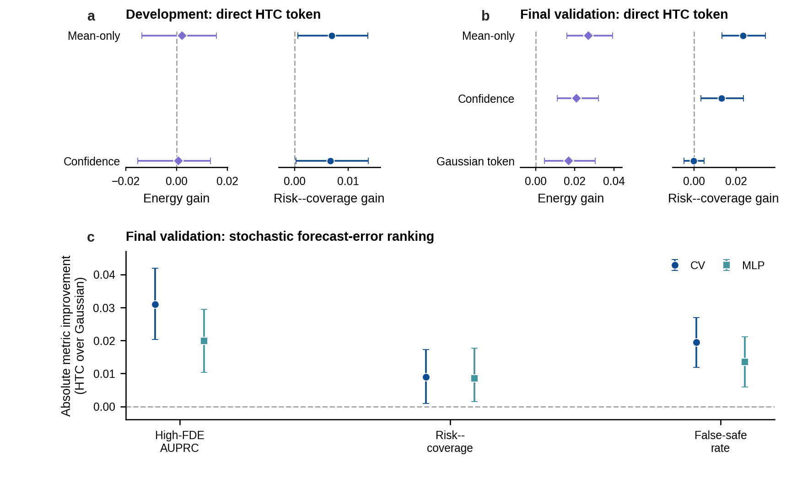

# Supplementary Appendix

## When Does Probabilistic 3D Perception Help Motion Forecasting? A Controlled Interface Study under Multimodal Sensor Degradation

> Companion to manuscript draft v0.6. This appendix preserves implementation and evidence-governance detail that is intentionally omitted from the main narrative. Implementation labels are cross-referenced as follows: **G = M1 Gaussian/wrapped-Gaussian perception**, **HTC = M2 Student-t/von Mises perception**.

## S1. Evidence Governance and Reproducibility Protocol

### S1.1 Why the development chronology is separated from the paper framework

The main paper organizes the experiments by three scientific levels--stochastic propagation value, representation utility, and objective necessity. The work was conducted through a sequence of pre-specified internal stages. This chronology is retained here so readers can distinguish the unified scientific interpretation from the order in which increasingly narrow explanations were tested.

| Internal stage | Scientific role in the paper | Pre-specified endpoint | Observed valid endpoint |
|---|---|---|---|
| R0 | Stochastic propagation value | Proceed only if the HTC pushforward improved over Gaussian and the mean-state current interface under quality, sharpness, risk, and stability criteria | 7/7 criteria passed; stochastic phenomenon supported |
| R1 and read-only R1.5 | Initial representation screening | Test dedicated encoding and interaction, then isolate the target-centric encoder without retraining | Encoder showed a local positive; interaction closed; encoder retained as bounded evidence |
| R2-Core | Matched representation/mechanism test | Proceed only if full encoding survived capacity, Gaussian-family, component, risk, sharpness, accuracy, and seed controls | 1/8 criteria passed; heavy-tail/circular DSE mechanism closed |
| R2-D | Learning-objective test | Proceed only if teacher preservation improved over an identical GT-only student while retaining MC behavior and efficiency | 5/6 criteria passed; preservation objective closed because GT-only was better on primary dev energy |
| R3-P | Direct representation necessity test | Support explicit conditioning only if the HTC token beat mean, confidence, and Gaussian controls under matched GT-only training | 2/6 criteria passed; universal learned-token necessity closed |
| Final confirmation | Post-development evaluation-population check | Evaluate all prewritten comparisons without changing a downstream model, metric, or claim category | Stochastic effect confirmed; learned-interface effects remained evaluation dependent |

A negative stage endpoint closed the associated explanation; it did not authorize post hoc tuning of that model. This is why the main paper reports locally positive results alongside the matched comparisons that limit their interpretation.

### S1.2 Pre-specification and retained evidence

For each stage, the following were recorded before the corresponding evaluation:

- scientific question and excluded scope;
- model groups and within-stage comparators;
- training, calibration, and evaluation rows;
- random seeds and device restrictions;
- primary and secondary metrics;
- paired-scene inference procedure;
- validity checks and terminal decision criteria; and
- retained artifact locations.

Retained outputs were written atomically and not overwritten. Source data, row identities, checkpoints, metric archives, and result summaries were linked by cryptographic hashes. A validity failure would have invalidated a run instead of being interpreted scientifically. Every stage reported in the manuscript passed its validity checks.

Machine-readable evidence used for the paper is consolidated in:

- `riskprop3d_paper/EVIDENCE_MATRIX.md`;
- `riskprop3d_paper/FINAL_CLAIM_LEDGER.md`;
- `riskprop3d_paper/OFFICIAL_EVIDENCE_TABLE.md`;
- `riskprop3d_paper/UPSTREAM_CHARACTERIZATION_TABLE.md`;
- `riskprop3d_paper/FINAL_CONFIRMATION_REPORT.md`; and
- `outputs/riskprop3d_final_confirmation/`.

### S1.3 Downstream final-validation access

The final-validation claim is deliberately narrow. It means that the **downstream forecasting outcomes and interface comparisons** on the nuScenes validation split were not read until downstream checkpoints, calibration rules, metrics, comparators, and claim categories were fixed. It does not assert that nuScenes validation data had never been used in any upstream detector-development context. After downstream access, no model was retrained, no temperature was refit, no loss weight or feature was changed, and no new comparator or primary metric was introduced. The internal test split remained unread.

### S1.4 Closest-work design comparison

**Table S1. Design-level positioning relative to the two closest
object-state uncertainty studies. The entries describe different research
questions and are not a quality ranking; “not isolated” means that the item
was not posed as the separate necessity contrast used in this paper.**

| Work | Upstream uncertainty | How uncertainty enters forecasting | Necessity controls emphasized | Sensor/degradation scope | Reported evidence boundary |
|---|---|---|---|---|---|
| Ivanovic *et al.* [23] | Perceptual state uncertainty | A statistical-distance objective encourages forecast uncertainty to match upstream perception uncertainty | Positive uncertainty-aware method evaluation; fixed-host stochastic-law value and an identical GT-only preservation control are not isolated as separate questions | Illustrative simulation and large-scale real-world trajectory data; no six-family Camera--LiDAR degradation matrix | Improved propagation and calibration |
| Cao *et al.* [26] | Perception-information uncertainty modeled from vehicle trajectories | Bi-GRU uncertainty modeling and data-confidence attention are integrated with temporal--spatial interaction encoding | Proposed-component and trajectory-prediction evaluation; stochastic-law, confidence/Gaussian-matched, and preservation-versus-GT-only questions are not separated into the present taxonomy | Interactive vehicle-trajectory prediction settings; not a controlled pair of Camera--LiDAR 3D predictive laws under six sensor degradations | Improved prediction accuracy and stability |
| This study | Two complete trained Camera--LiDAR 3D predictive laws with a common detector mean | Separately through 64-sample fixed-probe propagation, structured/direct learned representations, and a pushforward-preserving objective | Mean, confidence, Gaussian, capacity/initialization, and identical GT-only controls matched to the claim being tested | Six controlled sensor-degradation families, development evaluation, and held-out final-validation population | Stable stochastic value, conditional learned-interface utility, and retained null results |

## S2. Interface Implementation Details

### S2.1 Upstream probability heads

The detector host is a Camera--LiDAR BEVFusion/TransFusion model. Probability prediction is a side channel: it cannot change decoded box means, selected queries, class ordering, detector scores, non-maximum suppression, or detector parameters. The detector remains frozen throughout probability-head training; decoded means are stop-gradient detector outputs, and neither probability head can update the detector mean branch.

For each retained detector query, both probability heads receive:

- a 128-dimensional decoder-query feature;
- ten detached class logits;
- eight detached decoded linear-state means; and
- one detector score.

The resulting geometry conditioner has 147 inputs. Query density is excluded from the probability head. Each head contains:

```text
existence branch: Linear(128, 64) -> SiLU -> Linear(64, 1)
geometry branch:  Linear(147, 64) -> SiLU -> Linear(64, 10)
```

Both heads have 18,443 trainable parameters. The ten geometry outputs comprise eight linear scales, one auxiliary degrees-of-freedom raw coordinate, and one shared yaw-uncertainty raw coordinate. The Gaussian likelihood uses the linear scales and transforms the yaw coordinate into a wrapped-Gaussian scale; its degrees-of-freedom output is unused. The HTC likelihood uses the linear scales, transformed degrees of freedom, and a von Mises concentration derived from the yaw coordinate. The detector supplies the common linear and yaw means.

The Gaussian head uses a diagonal Gaussian linear likelihood and wrapped-Gaussian yaw likelihood. The HTC head uses a diagonal multivariate Student-t linear likelihood and von Mises yaw likelihood. Both are trained on the same 22,508 clean samples from 560 scenes for 20 epochs, using AdamW with learning rate `1e-3`, weight decay `1e-4`, batches of eight scenes, gradient norm cap 5, no scheduler, and three paired head seeds. The final epoch is retained. A disjoint clean label-calibration set contains 2,814 samples from 70 scenes. Family-specific geometry likelihood training and downstream calibration are reported separately; the two laws are not assumed to be equally calibrated by construction. Both predictive laws, all three head seeds, and the associated checkpoint hashes were fixed before any downstream forecasting outcome was evaluated. No downstream metric selected a law, checkpoint, epoch, or seed. Because the objectives learn different scales as well as different predictive-law forms, G versus HTC is a complete trained-law comparison rather than a pure distribution-family intervention.

The frozen clean pre-forecast characterization used in Main Table 2 is
computed on identical matched frozen-query rows from the clean development
evaluation within each head seed. NLL, natural coverage, and raw scales use
the probability heads' outputs without label-calibration temperatures or
post-hoc scale correction. Equal-coverage volume is the only post-hoc
descriptive entry: each law is rescaled on the same rows to empirical 90%
coverage. The label-calibration split supplies the separate forecasting
process-noise law described in Section S2.2 and does not alter these upstream
NLL or natural-coverage values.

| Quantity | Frozen characterization |
|---|---:|
| Full-geometry NLL, G - HTC | 4.10243 (95% CI 1.97022, 7.42856) |
| XY NLL, G - HTC | 0.12799 (0.11494, 0.14169) |
| Yaw NLL, G - HTC | 2.71034 (0.62140, 6.01430) |
| Linear 90% coverage gap | G: -0.03827; HTC: +0.01330 |
| Yaw 90% coverage gap | G: +0.02549; HTC: +0.03107 |
| Median linear-scale ratio, HTC/G | 0.758--0.791 across seeds |
| Equal-coverage 90% ellipsoid-volume ratio, HTC/G | 1.095--1.249 across seeds |

Positive NLL contrasts favor HTC; coverage gap is empirical minus nominal.
The favorable proper-score contrasts coexist with mixed calibration and wider
equal-coverage static volumes for HTC. The source crosswalk and interpretation
boundary are retained in `UPSTREAM_CHARACTERIZATION_TABLE.md`.

### S2.2 Level-I stochastic pushforward

The two forecasting probes are:

- `CV`: constant velocity; and
- `MLP`: a 64--128--128--12 residual network over constant velocity, with 26,380 trainable parameters.

The MLP is trained once for 15 epochs on clean training tracks and then held fixed. For each retained object, the input contains four padded historical 3D states, the current state, history mask, and class. Two to four consecutive historical observations span 1--2 s; six future centers span 3 s.

For each perception law, 64 current states are sampled and propagated through the same probe. G and HTC use common normal/uniform random numbers for compatible linear coordinates; wrapped-Gaussian and von Mises yaw use their native samplers. For each probe, clean label-calibration residuals fit six zero-mean 2D Gaussian covariances, one 2-by-2 covariance per future horizon; covariance eigenvalues are floored at `1e-4`. The mean-state current interface, G, and HTC share the same probe-specific law and common process-noise draws. No degraded or final-validation outcome enters the fit. Thus only the current-state predictive law changes within a probe comparison. Because the mean-state interface still receives future process noise, it is not a deterministic future distribution.

### S2.3 Structured representation controls

All learned representation groups use the same history/class input, constant-velocity residual, six-mode diagonal-Gaussian trajectory decoder, 15 clean-training epochs, and `mixture NLL + 0.1 * best-mode ADE` objective. Clean label-calibration selects one global output-scale temperature per group.

The capacity-matched groups are:

| Group | Distribution adapter |
|---|---|
| Mean-matched | Mean state and yaw sine/cosine; every uncertainty coordinate is constant |
| Gaussianized encoder | G linear variances, wrapped-Gaussian mean resultant, and Gaussian-limit tail constants |
| No-tail | HTC marginal moments, determinant, radial/principal scale, and circular concentration; explicit df/tail coordinates fixed |
| No-circular | HTC linear moments and tail coordinates; yaw concentration/resultant fixed |
| Full HTC encoder | HTC moments, determinant and principal/radial descriptors, tail coordinates, yaw mean, and circular concentration |

These five groups have identical trainable parameter counts and identical within-repetition initialization. The raw-concatenation group is deliberately simpler and is treated only as an initial representation baseline.

Evaluation-only mechanism strata include high current XY residual, far range, sparse LiDAR point-count proxy, yaw boundary, turning, future heading change, crossing, vehicle, two-wheeler, and high FDE. No stratum variable enters training or model inference.

### S2.4 Pushforward-preserving objective

Both students use an `84-96-64-150` MLP with 24,118 trainable parameters. Its 150 outputs parameterize six trajectory modes: mode weights and per-mode residual future means/scales over constant velocity. The 84 inputs are a 64-dimensional history/current/class vector and a 20-dimensional raw HTC token containing eight means, eight log scales, `log(df - 2)`, yaw-mean sine/cosine, and `log(1 + kappa)`.

The GT-only objective is

\[
L_{\mathrm{GT}}
=L_{\mathrm{mixture\ NLL}}/12
+0.1L_{\mathrm{best\ mode\ ADE}},
\]

with trajectory distances normalized by clean-training residual scales. The preservation student minimizes

\[
L_{\mathrm{preserve}}
=L_{\mathrm{GT}}
+1.00L_{\mathrm{transport}}
+0.25L_{\mathrm{moment}}
+0.25L_{\mathrm{calsharp}}
+0.25L_{\mathrm{risk}}.
\]

`L_transport` is a sample energy-distance estimator between the six-mode student and all 64 teacher trajectories, including cross and student-self terms. `L_moment` matches horizon-wise mean, log marginal variance, and XY correlation. `L_calsharp` matches teacher/GT Mahalanobis behavior and penalizes student final log determinant only when it exceeds the teacher. `L_risk` matches standardized final log-area risk ranking and batch correlation. There is no learned collision classifier or separate risk head.

Prediction runtime starts from the same upstream HTC parameters. Teacher time includes state sampling, 64 MLP propagations, and process-noise construction. Student time includes token construction, device transfer, and one forward pass. Downstream metric sampling is excluded for both.

### S2.5 Direct probability-token controls

All four direct-conditioning groups use the same `84-96-64-150` architecture, 24,118 trainable parameters, six-mode decoder, GT-only loss, batch order, 15 epochs, and within-repetition initialization. All use the common HTC detector mean so that a G/HTC mean discrepancy cannot explain an uncertainty effect.

| Group | Token information beyond common mean/yaw mean |
|---|---|
| Mean-only | All uncertainty coordinates fixed |
| Confidence | Detector score and `log(1 + query density)`; probability coordinates fixed |
| Gaussian token | G log scales, Gaussian-limit tail constant, and wrapped-Gaussian yaw precision |
| HTC token | HTC log scales, `log(df - 2)`, and `log(1 + kappa)` |

Each group has a separate clean-training input normalization because the token coordinates have different numerical meanings. Normalization buffers are not trainable.

## S3. Metrics, Statistical Inference, and Validity

### S3.1 Metric orientation

Trajectory energy score is primary and lower is better. Reported “gain” is oriented so that a positive number favors the named candidate. Exact sign conventions are stored with every result table. Mixture/shared-kernel NLL, predictive-mean ADE/FDE, empirical equal-coverage area, high-FDE AUPRC, risk--coverage, and false-safe rate remain secondary or diagnostic.

High FDE is defined by predictive-mean FDE above 2 m under the stage-specific reference. Risk uses predicted final log ellipse area. False-safe rate uses the lowest-risk 80% of tracks within scene. These are prediction-error metrics and should not be interpreted as collision or planning safety.

### S3.2 Paired-scene inference

Every decisive experiment contains three paired repetitions. Differences are calculated on common target rows, averaged within scene, and then averaged across paired repetitions. Confidence intervals use 10,000 paired-scene bootstrap resamples with seed `20260805`. The Monte Carlo equivalence test in the preservation stage uses a two-sided 90% bootstrap interval with a pre-specified ±2% energy margin. Seed directions are reported independently of the aggregate interval. Confidence intervals are not multiplicity-adjusted. Confirmatory interpretation is restricted to the pre-specified clean and family-level primary contrasts and their joint criteria; component, risk, and attribute-stratum intervals are secondary or descriptive, and no family-wise claim is based on an isolated interval.

### S3.3 Confirmatory, secondary, and descriptive inference roles

The table below makes the multiplicity boundary operational. “Stage-confirmatory” means that the contrast and its joint criterion were specified before the corresponding held-out evaluation. It does not imply a single family-wise error correction across all sequential stages. Secondary and descriptive rows support interpretation but cannot independently create or rescue a central claim.

| Scientific claim | Endpoint | Pre-specified comparison | Inferential role |
|---|---|---|---|
| Stochastic propagation value | Trajectory energy score | HTC versus G and mean-state propagation on clean and family aggregates, separately for CV and MLP | Stage-confirmatory; central paper claim |
| Structured representation utility/mechanism | Trajectory energy score | Full HTC encoder versus capacity-matched mean and Gaussianized controls, with pre-specified component/stability criteria | Stage-confirmatory within the mechanism audit; final interpretation bounded by the valid negative endpoint |
| Direct probability-token necessity | Trajectory energy score | HTC token versus mean-only, confidence, and Gaussian tokens under identical GT-only training | Stage-confirmatory within the necessity audit; cross-population heterogeneity retained |
| Preservation-objective necessity | Trajectory energy score | Preservation student versus identical GT-only student; MC comparison evaluated separately | Stage-confirmatory within the objective audit |
| Sharpness and mean accuracy | Equal-coverage area; ADE/FDE | Same paired interfaces as above | Pre-specified secondary constraints |
| Forecast-error ranking | High-FDE AUPRC, risk--coverage, false-safe rate | Same paired interfaces as above | Pre-specified secondary; no collision/planning claim |
| Likelihood diagnostics | Exact/shared-kernel trajectory NLL | Same paired interfaces as above | Diagnostic because likelihood constructions differ across empirical and learned mixtures |
| Encoder components and track attributes | Energy/risk within component or attribute strata | No-tail/no-circular and evaluation-only strata | Secondary or descriptive; no isolated subgroup interval supports a family-wise claim |

### S3.4 Validity controls

Stage-specific validity checks include:

- source detector/probability-head/checkpoint hashes;
- row-by-row agreement of sample token, instance token, input, and future arrays across reused datasets;
- scene-disjoint train, label-calibration, development, and final-validation populations;
- absence of corruption identity and current GT residual from inputs;
- identical architecture, parameter count, initialization, batch order, and objective where required;
- complete pre-specified seed tuples and common evaluation rows;
- exact replay of retained stochastic baselines when reused;
- finite retained numerical values; and
- no internal-test access.

All reported runs passed their corresponding validity checks. Full validity reports and numeric counts remain in the stage result files.

## S4. Component and Attribute Analyses

### S4.1 Pre-specified encoder-mechanism strata

The matched encoder audit did not support a component-level mechanism. Full
HTC encoding improved clean all-track energy over the no-tail control by
0.00796 (95% CI 0.00080, 0.01570), but none of the pre-specified
tail-sensitive strata produced the required significant enhancement. The
largest tail-stratum point effect was 0.02451 on high-FDE tracks, with an
interval spanning zero (-0.00525, 0.05561). Full HTC was non-significantly
worse than the no-circular control on clean data by 0.00228, and the
two-wheeler stratum significantly favored removing circular concentration
(-0.04457; -0.10014, -0.00186). These strata were evaluation-only and cannot
be used to rescue a tail or circular claim.

### S4.2 Descriptive track attributes

The development archives were stratified descriptively by range, class group, speed, LiDAR point-count proxy, current XY residual quartile, and history length. The analysis was performed after model fitting, introduced no new gate, and was not used to select a model or metric.

The HTC-over-Gaussian stochastic energy direction was broadly positive across strata and often larger under degraded conditions. Several far-range, vehicle, and higher-residual strata showed larger point effects. In contrast, Gaussian-token-minus-HTC-token effects were heterogeneous, small, or reversed. These results are consistent with the aggregate distinction between stochastic and learned interfaces, but they do not identify tail behavior, yaw periodicity, distance, sparsity, or sensor physics as a causal mechanism.

The publication supplement should include the complete precomputed stratified tables rather than selecting favorable rows. No additional significance-based subset narrative is authorized.

## S5. Detailed Cross-Population Results

**Table S2. Held-out-degradation HTC-over-Gaussian trajectory-energy gains.
Positive values favor HTC stochastic propagation.**

| Degradation family | CV gain (95% CI) | MLP gain (95% CI) |
|---|---:|---:|
| Camera extrinsic rotation | 0.02411 (0.01750, 0.03089) | 0.02260 (0.01765, 0.02785) |
| Camera extrinsic translation | 0.01635 (0.01085, 0.02211) | 0.01595 (0.01156, 0.02053) |
| Camera temporal offset | 0.01888 (0.01337, 0.02445) | 0.01634 (0.01213, 0.02077) |

**Table S3. Complete final-validation learned-interface contrasts. Values are
baseline minus candidate; positive energy favors the candidate.**

| Interface | Candidate | Baseline | Energy effect (95% CI) | Equal-coverage area ratio | Seed signs |
|---|---|---|---:|---:|---|
| Structured representation | Full HTC encoder | Mean-matched | 0.03115 (0.01784, 0.04570) | 1.0728 | + / + / - |
| Structured representation | Full HTC encoder | Gaussianized encoder | 0.02827 (0.01518, 0.04142) | 0.9648 | + / + / - |
| Structured representation | Full HTC encoder | No-tail | 0.00046 (-0.01038, 0.00928) | 0.9606 | + / + / - |
| Structured representation | Full HTC encoder | No-circular | 0.01110 (0.00467, 0.01837) | 0.9919 | + / + / - |
| Direct conditioning | HTC token | Mean-only | 0.02702 (0.01588, 0.03932) | 0.9874 | + / + / + |
| Direct conditioning | HTC token | Confidence | 0.02092 (0.01112, 0.03217) | 0.9849 | + / + / + |
| Direct conditioning | HTC token | Gaussian token | 0.01682 (0.00456, 0.03051) | 0.9723 | + / - / + |



**Supplementary Fig. S1 | Proper-score and forecast-error-ranking boundary.** **a,** On development data, direct HTC-token trajectory-energy effects over mean-only and confidence span zero, whereas risk--coverage effects are positive. **b,** On final validation, direct-token energy and risk--coverage effects are shown against mean-only, confidence, and Gaussian-token controls; risk--coverage remains comparator dependent. **c,** Final-validation HTC-over-Gaussian stochastic effects for high-FDE AUPRC, risk--coverage, and false-safe rate under CV and MLP. Positive values favor HTC. Error bars are 95% intervals from 10,000 paired-scene bootstrap resamples over three paired replicates. Development uses \(n=70\) scenes; final-validation energy/risk--coverage uses \(n=150\), while official AUPRC and false-safe contrasts use 147 evaluable scenes. These metrics quantify forecast-error triage, not collision or planning safety. Source data are provided in `figures/source_data/figure_s1.csv`.

## S6. Claim Ledger for Manuscript Wording

### Supported

- Under correct object identity and controlled CV/MLP probes, the evaluated trained HTC law improves downstream trajectory energy under stochastic propagation relative to the trained Gaussian law and the mean-state current interface across the original and held-out degradation families and final validation.
- The stochastic gain is compatible with smaller equal-coverage regions and better future-error ranking.
- The empirical MC pushforward can be approximated by a much faster single-pass student.

### Bounded or local

- A dedicated distributional encoder can improve over raw concatenation in a particular paired experiment.
- Direct HTC conditioning can improve energy on the final-validation population and can retain risk-ranking value in some development/transfer comparisons.
- A preservation student can improve over its MC teacher.

### Not supported

- A stable heavy-tail or circular-yaw causal mechanism for the learned encoder.
- Universal necessity of explicit HTC tokens under ordinary future-GT supervision.
- Necessity of preserving the MC pushforward as a training objective when future labels are available.
- Robustness to association error, modern map-aware/interaction-heavy hosts, missing modalities, long-horizon world prediction, collision reduction, or safer planning.
